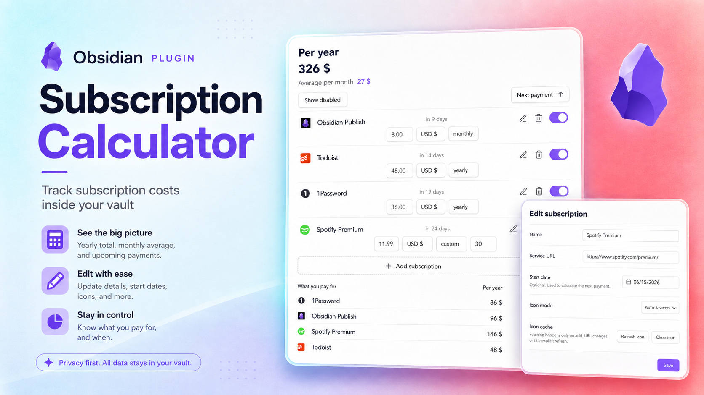

# Subscription Calculator



*See what your subscriptions really cost — without leaving Obsidian.*

Subscription Calculator gives you one clear place to track recurring payments, check upcoming charges, and understand your monthly and yearly spending.

## Made for your vault

Your subscription data stays in Obsidian without dependencies. You do not need a separate service, one note per subscription, Dataview, Bases, or frontmatter.

Tracking and calculations work offline. Website **icons** are **cached locally**, with no network requests during normal viewing. Fetching icons uses Google S2 and sends the service's domain; you can disable fetching in the plugin settings.

## Your subscriptions at a glance

- See the **total cost per year** and the **average per month**.
- **See upcoming** renewals when a start date is set.
- Add a service URL for its **favicon**.
- **Pause a subscription** without deleting it or including it in your totals.
- Keep different currencies separate, with no misleading conversions.
- Update the price, currency, or billing period directly from the subscription card.

**Sort by:**
  - Name
  - Status
  - Next payment

Choose from weekly, monthly, quarterly, yearly, or custom billing periods.


## Installation and usage

0. Install [**Subscription Calculator**](https://community.obsidian.md/plugins/subscription-calculator) from Obsidian Community plugins.
1. Open **Subscriptions** from the ribbon or run **Open subscriptions** from the command palette.
2. Select **Add subscription** and enter its name, price, currency, and billing period.
3. Optionally add a start date for next-payment tracking or a service URL, then select **Add**.

Your totals and next payment dates update automatically. Use the switch on a subscription card to include or exclude it from your active spending. Open the edit menu whenever you want to change its details or use an emoji instead of the website icon.

Choose whether to open subscriptions in the **right sidebar** or a **main tab** in the plugin settings.

## Currencies

USD, EUR, GBP, CHF, RUB, and JPY are included. Add your own currencies in the plugin settings under **Custom currencies**, with a custom label, amount marker, and whole-number or decimal prices. You can also track points, credits, or tokens.

Each currency has its own totals, with no automatic conversion.

## Backup and restore

Use **Backup and restore** in the plugin settings to export or restore subscriptions, settings, and custom currencies as JSON. **Restoring a backup replaces your current data; it does not merge records.** Cached website icons are excluded from backups.

## Command line

Manage subscriptions from your terminal, scripts, or AI assistant. Obsidian must be running with its CLI enabled.

These commands use Obsidian's native CLI, so they follow its clunky syntax: `plugin-id:command` and `parameter=value`. On Windows, use `Obsidian.com` instead of `obsidian` due to a current limitation of Obsidian's official CLI.

**Find subscriptions and check your spending:**

```sh
obsidian subscription-calculator:list
obsidian subscription-calculator:list status=enabled currency=USD
obsidian subscription-calculator:get name="Netflix"
obsidian subscription-calculator:summary
```

`list` shows subscription names and IDs. Use `get id="..."` when names repeat. Totals include enabled subscriptions and keep currencies separate.

**Add a subscription or update its details:**

```sh
obsidian subscription-calculator:currencies
obsidian subscription-calculator:new name="Netflix" price=12.34 currency=USD period=monthly
obsidian subscription-calculator:new name="eSIM" price=5 currency=USD period=custom days=30
obsidian subscription-calculator:set id="ID from list" price=15.99 period=monthly
```

Use a currency **code** from `currencies`. Billing periods can be weekly, monthly, quarterly, yearly, or custom. `set` changes only the fields you provide and requires the subscription's exact ID. Include a price when changing currency.

Add `start-date=2026-11-01` for next-payment tracking or `url=netflix.com` for a website icon. Use `status=disabled` to pause a subscription.

With `set`, use `clear-url` or `clear-start-date` to remove the corresponding value.

**Preview changes and use structured output:**

```sh
obsidian subscription-calculator:set id="ID from list" price=17.99 dry-run
obsidian subscription-calculator:summary format=json
obsidian subscription-calculator:export > backup.json
```

`dry-run` previews an addition or update without saving. All commands except `export` support `format=json`; errors appear in CLI output. Automated callers should validate the JSON response and check `apiVersion: 1` and `ok: true`, because Obsidian can return exit code zero on errors.

`export` produces a JSON backup for **Restore backup**. Redirecting output overwrites the destination file.

With PowerShell 5.1, export as UTF-8:

```powershell
Obsidian.com subscription-calculator:export | Out-File backup.json -Encoding utf8
```

Add `vault="My Vault"` before the command to select a vault.


## Alternatives

Options for tracking subscriptions in Obsidian are limited in convenience, and most options are not quite about subscription tracking: they lean toward finance history, spread subscription data across many files, or live in external spreadsheets. That gap led to this plugin. Here is what I found.

**[fkonovalov/obsidian-subscription-tracker](https://github.com/fkonovalov/obsidian-subscription-tracker)** - The best option if you want subscription tracking built directly on Obsidian Bases. It is a native, lightweight vault setup with subscription notes, Bases formulas, favicon support, and multi-currency support through manually edited or optionally auto-updated currency rates. The trade-off is that the workflow stays note-based: each subscription is a separate Markdown note with frontmatter.

**Expense and finance trackers** - Plugins like **[lberts/personal-finance](https://github.com/lberts/personal-finance)**, **[uuq007/obsidian-cashlog](https://github.com/uuq007/obsidian-cashlog)**, **[fengshuzi/coin-memo](https://github.com/fengshuzi/coin-memo)**, and **[thekalpit/tare-money](https://github.com/thekalpit/tare-money)** are about expenses, transactions, and money history. They can include subscription payments, but they do not treat subscriptions as a separate list of services to monitor.

**Ledger-based accounting tools** - **[mkshp-dev/obsidian-finance-plugin](https://github.com/mkshp-dev/obsidian-finance-plugin)** and **[bzimor/obsidian_hledger](https://github.com/bzimor/obsidian_hledger)** are built around Beancount or hledger workflows. They assume a ledger/accounting setup; Beancount Ledger also requires Python and local Beancount CLI packages. That is much broader and heavier than a lightweight subscription tracker.

<ins>**Custom Bases, Dataview, spreadsheets, and CSV workflows**</ins> - A similar tracker can be assembled with Bases views, Dataview queries, spreadsheets, or CSV files. This can be flexible, but it also means maintaining your own structure, views, sorting, and manual data files instead of using a focused subscription workflow.
